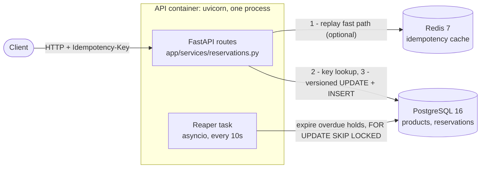
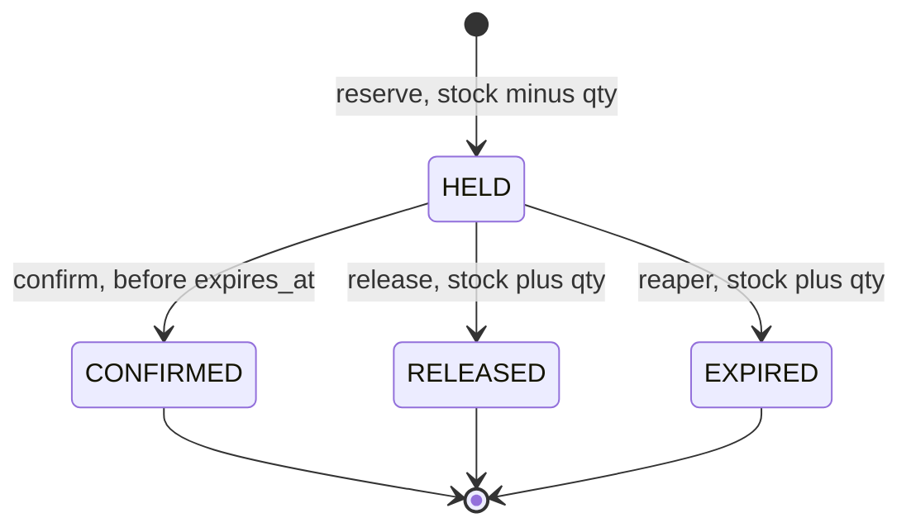

# Real-Time Inventory Reservation Service

A service that **holds stock for a short time when a customer starts checkout**. Each
hold is later **confirmed** (order placed), **released** (customer cancelled), or
**expired** by a background reaper so abandoned carts give their stock back.

It guarantees three things, even with hundreds of concurrent requests on one SKU:

1. **Never oversell.** Stock can't go below zero.
2. **Idempotent writes.** A client retrying a request with the same `Idempotency-Key`
   gets the same result and never reserves twice.
3. **Holds expire.** Abandoned holds return to stock automatically.

**Stack:** Python 3.12 · FastAPI + Uvicorn · PostgreSQL 16 (SQLAlchemy 2.0 async Core +
asyncpg, raw SQL) · Redis 7 · pytest · Locust · Docker Compose.

---

## Architecture



- **PostgreSQL is the source of truth.** The stock counter, the reservations, the
  idempotency guarantee (`UNIQUE idempotency_key`) and the last line of defence against
  overselling (`CHECK (available >= 0)`) all live there.
- **Redis is only a cache** for replaying idempotent responses. If Redis is down, every
  request still works correctly through Postgres. It's just slower (each Redis call
  times out after 1s).
- **The reaper** is an asyncio task started in the FastAPI lifespan. It is safe to run in
  several replicas at once.

### Reservation state machine



Every other transition is rejected. Each transition is a single conditional `UPDATE … WHERE
status = 'HELD'`, so when two actions race on the same hold (confirm vs release, release
vs reaper), Postgres' row lock lets exactly one win.

**Invariant** (checked by tests, `/admin/invariants` and the load test), per product:
`available + SUM(qty WHERE status IN ('HELD','CONFIRMED')) = total_qty`

### Project layout

```
app/
  main.py               FastAPI app, lifespan (DB pool, Redis, reaper task)
  config.py             settings from env vars (validated at startup)
  db.py                 async engine, runs schema.sql on startup
  schema.sql            tables, constraints, indexes
  models.py             request/response schemas
  errors.py             error codes + handlers
  idempotency.py        Redis cache for replays
  services/reservations.py  reserve / confirm / release (the core)
  services/reaper.py        background expiry
  routes/               products, reservations, health + /admin/invariants
tests/                  pytest suite (real Postgres + Redis)
loadtest/               seed.py, locustfile.py, verify.py
```

---

## API

All errors have the body `{"error": {"code": "<CODE>", "message": "<text>"}}`.

| Method & path | Purpose | Success | Errors |
|---|---|---|---|
| `POST /products` | Create `{sku, name, total_qty}` (`available = total_qty`) | 201 | 409 `SKU_EXISTS` · 422 `VALIDATION_ERROR` |
| `GET /products/{id}` | Current stock | 200 | 404 `NOT_FOUND` |
| `POST /reservations` | Hold stock. **`Idempotency-Key` header required.** Body `{product_id, qty}` | 201 new · 200 replay (+ `Idempotent-Replayed: true`) | 400 `MISSING_IDEMPOTENCY_KEY` · 400 `INVALID_IDEMPOTENCY_KEY` (over 255 chars) · 404 `NOT_FOUND` · 409 `OUT_OF_STOCK` · 422 `IDEMPOTENCY_KEY_REUSED` (same key, different body) · 422 `VALIDATION_ERROR` · 503 `BUSY` (+ `Retry-After: 1`) |
| `GET /reservations/{id}` | Read a reservation (current state) | 200 | 404 `NOT_FOUND` |
| `POST /reservations/{id}/confirm` | HELD → CONFIRMED | 200 (also if already CONFIRMED) | 404 · 409 `INVALID_STATE` (RELEASED) · 410 `EXPIRED` |
| `DELETE /reservations/{id}` | HELD → RELEASED, stock returned | 200 (also if already RELEASED) | 404 · 409 `INVALID_STATE` (CONFIRMED/EXPIRED) |
| `GET /health` | DB + Redis reachable | 200 `{"db":"ok","redis":"ok"}` | 503 (failing part marked `"error"`) |
| `GET /admin/invariants` | Per-product invariant check | 200 `{"ok": true, "products": [...]}` | — |

Reservation body: `{id, product_id, qty, status, expires_at, created_at}`.

**Idempotent replays return the original response.** That body has `status: "HELD"`
because that's what the original 201 said, even if the hold has since been confirmed,
released or expired. The response is the same whether it comes from Redis or Postgres.
Use `GET /reservations/{id}` for the current state.

Interactive docs: http://localhost:8000/docs

---

## Run it

Requires Docker (Docker Desktop on Windows/macOS).

```bash
docker compose up -d --build
curl localhost:8000/health        # {"db":"ok","redis":"ok"}
```

The API is on `:8000`, Postgres on `:5432` (user/password/db `inv`/`inv`/`inventory`) and
Redis on `:6379`. Configuration is via env vars. See [.env.example](.env.example):

| Variable | Default | Meaning |
|---|---|---|
| `HOLD_TTL_SECONDS` | 120 | How long a hold lasts before it may expire |
| `REAPER_INTERVAL_SECONDS` | 10 | How often the reaper runs |
| `REAPER_BATCH_SIZE` | 500 | Holds expired per reaper transaction |
| `IDEMPOTENCY_TTL_SECONDS` | 86400 | How long Redis keeps replay entries |
| `MAX_RESERVE_RETRIES` | 5 | Optimistic-lock attempts before 503 `BUSY` |
| `DB_POOL_SIZE` | 20 | Postgres connections per process (+10 overflow) |

Invalid values (e.g. `REAPER_BATCH_SIZE=0`) stop the app at startup with a clear error.

A quick walk-through:

```bash
curl -X POST localhost:8000/products -H "Content-Type: application/json" \
     -d '{"sku":"DEMO-1","name":"Demo","total_qty":5}'
curl -X POST localhost:8000/reservations -H "Content-Type: application/json" \
     -H "Idempotency-Key: 7d1c0a1e-demo" -d '{"product_id":1,"qty":2}'
curl -X POST localhost:8000/reservations/<id>/confirm
curl localhost:8000/products/1
```

> **Windows PowerShell 5.1** mangles quotes passed to `curl.exe`. Put the JSON in a
> file and send it with `--data-binary "@body.json"`, or use Git Bash.

---

## Test

The tests run against the real Postgres and Redis from compose. They use their **own
database (`inventory_test`, created automatically) and Redis DB 1**, so they never touch
the data of the running API.

```bash
python -m venv .venv
source .venv/bin/activate          # Windows: .venv\Scripts\activate
pip install -r requirements.txt
docker compose up -d               # if not already running
pytest -q
```

What the 77 tests cover:

| File | Covers |
|---|---|
| `test_reserve.py` | product API, reserve happy path, out of stock, 404, missing/invalid key, strict ints, 503, the DB `CHECK` |
| `test_concurrency.py` | **100 concurrent reserves on stock 10 → exactly 10 succeed**, invariant holds |
| `test_idempotency.py` | replay (Redis and DB), 422 on a reused key, **20 concurrent same-key requests → one reservation**, Redis down, errors not cached |
| `test_confirm_release.py` | the full state table, double-confirm/release, confirm after expiry, confirm-vs-release race |
| `test_reaper.py` | expiry + stock return, batching, **4 concurrent reapers**, reaper vs release/confirm races, loop survives errors, `/admin/invariants` |
| `test_health.py` | health checks, hung-DB timeout, config validation |

---

## Load test

200 users hammer one hot SKU with 50 units. Every request is a new customer with a fresh
`Idempotency-Key`. Run this with the virtual environment from [Test](#test) active.

```bash
# holds must not expire mid-test
HOLD_TTL_SECONDS=600 docker compose up -d      # PowerShell: $env:HOLD_TTL_SECONDS=600; docker compose up -d

python loadtest/seed.py                        # creates HOT-1 (50 units), prints its id
locust -f loadtest/locustfile.py --headless -u 200 -r 50 -t 30s --host http://localhost:8000 --csv loadtest/results
python loadtest/verify.py                      # prints INVARIANT OK, exits non-zero on failure

docker compose up -d                           # back to the default 120s holds
```

`seed.py` is re-runnable: it deletes only the old HOT-1 and its reservations. Locust
counts 201 and 409 as success, counts 503 separately, and treats anything else as a
failure. Per-status counts are saved to `loadtest/results_status_counts.json`.
`verify.py` checks `/admin/invariants`, queries Postgres directly, and cross-checks that
Locust's 201 count equals the reservation rows.

### Results

Run on a 24-thread Windows laptop, Docker Desktop, one uvicorn process:

| Metric | Value |
|---|---|
| Requests | 8,221 in 30 s (~300 req/s), **0 failures** |
| `201` reserved | **50**, exactly the stock |
| `409` out of stock | 8,017 |
| `503` busy | 154 |
| Latency | p50 530 ms · p95 1.1 s · p99 1.4 s · max 2.2 s |
| `verify.py` | `HELD=50, available=0` → **INVARIANT OK** |

Throughput and latency vary with what else the machine is doing. A later run from a
fresh clone did 3,802 requests (p50 1.2 s, one `503`). The correctness results don't
vary: every run sold **exactly 50** with **INVARIANT OK**.


**What the numbers show:**

- **Correctness held under contention.** Over 8,000 requests chased 50 units. Exactly 50
  were sold, nothing was oversold, and nothing was lost.
- **The 503s are the hot-SKU retry storm.** In the first seconds, while stock remained,
  ~30 requests at a time read the same `version`. One wins each round and the rest retry.
  154 lost 5 rounds in a row and got `503 BUSY` + `Retry-After: 1`, even though stock was
  still available.
- **The bottleneck was the API process, not the database.** During the run the API
  container sat at ~100% of one CPU core, Postgres at ~25%, Redis at ~3%. The latency is
  requests queueing for a single Python worker.

---

## Design decisions & tradeoffs

**Optimistic vs pessimistic locking.** A reserve reads `available, version` without a lock,
then runs `UPDATE … SET available = available - :qty, version = version + 1 WHERE id = :pid
AND version = :v AND available >= :qty`. If another request changed the row in between,
0 rows are updated and the request retries with jittered exponential backoff
(`random(0, 5ms·2^attempt)`). No lock is held while the app is "thinking". That suits a
catalogue of many SKUs with low contention on each. Pessimistic locking (`SELECT … FOR
UPDATE`) is simpler and never needs retries. But it holds the row lock across the round
trip and queues every request on a hot row behind it.

**What breaks on a hot SKU, and the fixes.** With 200 users on one row, most version checks
fail. The result is a retry storm: wasted round trips, 503s and latency, all visible in
the load test. Fixes, in increasing order of effort:
1. Jittered backoff (done).
2. Drop the version check and rely on the atomic conditional decrement
   (`available >= :qty`). It's already correct on its own and needs no retries.
3. Put a Redis `DECRBY` gate in front, so only requests likely to succeed reach Postgres.
4. Run more API workers. The load test shows the single Python process is the current
   ceiling.

**Defence in depth against overselling.** Four layers: the app's stock check, the
conditional `WHERE available >= :qty`, the `CHECK (available >= 0)` constraint, and the
invariant checks in tests and the load test. The decrement and the reservation `INSERT`
share one transaction, so a failure leaves no half-state.

**Why idempotency.** Networks time out *after* the server has committed. Without a key, the
client's retry reserves twice. The `UNIQUE idempotency_key` in Postgres is the real
guarantee. Two requests with the same key at the same instant can't both insert. The
loser's `INSERT` fails, its whole transaction (including its stock decrement) rolls back,
and it returns the winner's reservation. Redis is just a fast path: only successful 201s
are cached, so a client can retry after `OUT_OF_STOCK`. Every Redis call degrades to
Postgres on failure.

Two refinements beyond the original design, both found while testing:
- **A duplicate that loses the race for the last unit used to get a false `409`/`503`.**
  The reserve path now re-checks the key before returning `OUT_OF_STOCK` or `BUSY`.
  Example: 20 same-key requests taking the last stock now give 1 × 201 + 19 × 200,
  instead of 1 × 201 + 19 × 409.
- **Replays return the original response from both Redis and Postgres**, so the answer
  never depends on what the cache happens to hold.

**Why a reaper instead of checking expiry on read.** Expired stock must actually return to
`available` so other buyers can take it. The reaper expires holds in batches. Each batch is
one transaction: mark the holds `EXPIRED`, then add their quantity back per product.
`FOR UPDATE SKIP LOCKED` lets several replicas run reapers without double-releasing, since
each skips rows another has locked. Products are updated in sorted id order so two
reapers can't deadlock. A confirm racing the reaper is safe because both are conditional
on `status = 'HELD'`, and the row lock lets only one win.

**Smaller hardening.**
- Strict integer validation (`"1"`, `1.0`, `true` → 422).
- Keys over 255 characters are rejected with a 400. Postgres can't index more than ~2.7 KB,
  and longer keys used to cause a 500.
- Startup config is validated.
- Schema creation takes an advisory lock, so replicas starting together don't crash.
  `CREATE TABLE IF NOT EXISTS` isn't concurrency-safe.
- `/health` gives up on the DB after 2 s.

**Known MVP limits.**
- Single region.
- No auth.
- The reaper runs inside the API process (production would use a separate worker).
- One uvicorn process.
- No outbox/events for downstream systems.
- While Redis is down, each reserve pays ~2 s of Redis timeouts. A circuit breaker
  would avoid this.
- Postgres data isn't on a named volume, so `docker compose down` resets it.
- The dev image also contains the test and load-test tools.
